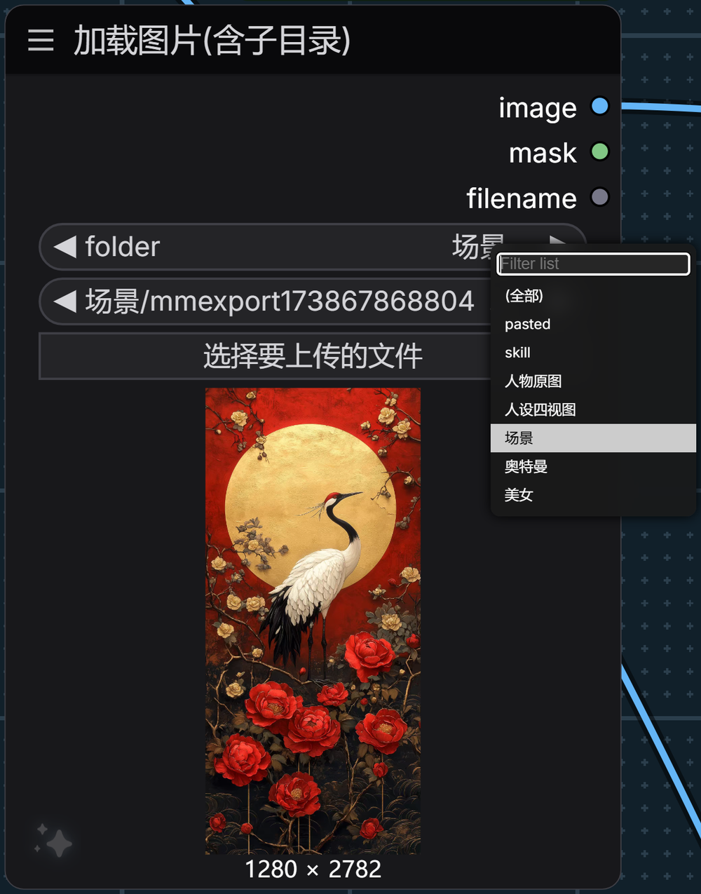

# Load Image (Recursive)

A drop-in replacement for ComfyUI's built-in **Load Image** node that also lists
images from **sub-directories** of `ComfyUI/input`, adds a **folder dropdown** to
filter the list, and — unlike the other subfolder loaders — actually makes those
sub-directory images **load**: canvas preview, image viewer and mask editor all
work, instead of being handed a path that can only 404.

> 中文说明见 [下方](#中文说明)。



---

## The problem

The stock `Load Image` node only lists files sitting **directly** in
`ComfyUI/input`. Anything you filed into folders is invisible:

```
input/
├── 001.png              ← visible
├── portraits/
│   └── maya.png         ← invisible
└── scans/
    └── 2026/
        └── roll-01.tif  ← invisible
```

So you end up either dumping everything into one flat folder, or copying files
out of your library every single time.

There are already a few "load image from subfolder" nodes around. They solve the
listing problem and then hit a second wall: **the image never actually loads.**
ComfyUI resolves a `/view` filename against the `input` root, so a value like
`scans/2026/roll-01.tif` can only ever 404 — blank canvas preview, blank viewer,
and nothing for the mask editor to open. That is a gap in ComfyUI's server rather
than in those nodes, and this node closes it.

## What it does

1. **Recursive listing** — every image under `input/`, at any depth, with paths
   relative to `input` (`scans/2026/roll-01.tif`).
2. **Folder dropdown** — pick a folder and the image list narrows to just that
   folder's own files, without pulling in anything from its sub-folders. Turns a
   1200-entry scroll into a 40-entry scroll. A dedicated root-folder entry
   isolates the files sitting directly in `input/`, so the top level stays
   browsable on its own instead of only being reachable through the "all" entry.
3. **Sub-directory images actually load** — canvas preview, image viewer and mask
   editor all work for files in subfolders, because the real path is resolved
   before ComfyUI's `/view` handler sees it. Preview-sized requests are capped at
   384 px, so browsing a folder does not pull every file down at full
   resolution.
4. **Bidirectional sync** — pick an image and the folder dropdown jumps to its
   folder; pick a folder and the list filters.
5. **The ◀ ▶ arrows wrap around** — stepping past the last image lands on the
   first, and stepping back from the first lands on the last. Stock combos go
   grey and stop at either end.
6. **A lock on the folder control** — the folder widget carries a padlock at its
   left end. While locked, that widget's ◀ ▶ arrows are disabled: they are drawn
   in the disabled colour and no longer change the value, so a stray click near
   the edge of the control while you are picking an image cannot move the
   folder. Locking also stops the folder from following the image selection.
   Picking a folder from the dropdown still works as before — the lock covers
   the arrows only. The state is saved with the workflow.
7. **A light-weight mask editor** — the `mask_edit` button (or right-click →
   *Edit mask*) opens a brush panel on top of the current image. Left-drag to
   paint, right-drag to resize the brush, wheel to zoom, space-drag to pan.
   Auto-fill holes closes a region from its outline alone, so you trace a
   silhouette instead of filling it in. Toggle between colour-overlay view
   (default: the photo plus green strokes) and black-and-white mask view. Saved
   masks land in `input/clipspace/` under ComfyUI's own
   `clipspace-painted-masked-*.png` naming, with the mask stored in the alpha
   channel — the same contract the stock mask editor uses, so the `MASK` output
   works with no backend changes and either editor can reopen the other's file.
8. **Right-click tools** — folder bookmarks (add / jump / remove), the last 8
   images you loaded, landscape-only and portrait-only filtering, an EXIF panel
   (focal length, aperture, shutter, ISO, camera), and an export that writes the
   current mask to `output/` as a black-and-white PNG.

> **Making a painted mask actually do something**
>
> The mask lives in the image file's **alpha channel**. On save the node's
> `image` widget is repointed at that new file, so **no extra node is needed to
> "apply" the mask**. The `IMAGE` output is untouched (RGB preserved), so your
> main graph behaves exactly as before — the mask just travels along with the
> image.
>
> The `MASK` output, however, **has to be connected** for anything to happen:
>
> | Goal | Wire `MASK` into |
> |---|---|
> | Repaint only inside the mask | `SetLatentNoiseMask` before the sampler |
> | Classic inpainting | the mask input of `VAEEncodeForInpaint` / `InpaintModelConditioning` |
> | Crop / composite / feather | `ImageCompositeMasked`, `MaskBlur`, `GrowMask`, … |
>
> Leaving `MASK` dangling means painting has no effect — that's a general
> ComfyUI rule, not something specific to this node.
>
> One more thing: a plain JPEG has no alpha channel, and the stock `LoadImage`
> then returns a **64×64** all-zero mask, which trips a shape mismatch in nodes
> that expect an image-sized mask. This node expands it to a full-size all-zero
> mask instead — same meaning ("no mask"), but nothing downstream breaks.


Everything else is inherited from the stock node, unchanged: decoding, EXIF
handling, alpha→mask, the upload button, drag & drop, paste, mask editor,
path-safety checks. Outputs are identical (`IMAGE`, `MASK`, `STRING`).

## Install

```bash
cd ComfyUI/custom_nodes
git clone https://github.com/yadoo7/load_image_recursive.git
```

Restart ComfyUI. No dependencies, no patch scripts, nothing to configure.

## Usage

Add **Load Image (Recursive)** from the `image` category (or search for
`recursive`, `subfolder`, `子目录`).

| Widget | What it does |
|---|---|
| `folder` | Filter only. `(全部)` / `(All)` shows everything. **Does not affect the output.** The padlock at its left end toggles the lock. |
| `image` | The actual pick. Paths include the sub-folder, e.g. `scans/2026/roll-01.tif`. |
| *(upload button)* | Same as the stock node. Uploaded files land in the root of `input/`. |

Switching folders changes the current image **only when that image is not in the
new folder**: the node then selects the first entry of the folder and refreshes
the canvas preview, so the preview never keeps showing a file the list no longer
contains. An image that is still in the new folder is left alone.

**Locking the folder.** Click the padlock at the left end of the `folder` widget
(or right-click → *锁定目录（停用左右箭头）*). Two things happen: the widget's
◀ ▶ arrows are disabled, and the folder stops following the image selection.
The arrows are disabled on purpose — while you are picking images, a click that
lands a few pixels off the `image` widget hits the folder arrows instead and
silently changes the directory. Locking removes that failure mode. Choosing a
folder from the dropdown is unaffected, so the lock never prevents a deliberate
change. The lock state is written to the workflow's node properties.

### Keeping the list fresh

`INPUT_TYPES` is only fetched when the node is created, so a list built then goes
stale as soon as you add a folder or drop a file into `input/`. Three paths
rebuild it, and they all go through the same authoritative `/object_info` call:

1. **Automatically** when ComfyUI rebuilds combo lists — via the official
   `refreshComboInNodes` extension hook. Without this the rebuild would wipe the
   folder filter, since ComfyUI assigns `options.values` wholesale.
2. **After using the upload button** (the value lands a moment later, so the
   rebuild is deferred).
3. **Manually**, right-click the node → **⟳ 刷新图片列表**.

Refreshing **keeps your folder selection** — it only rebuilds the lists. If the
folder you were on no longer exists, it falls back to `(全部)`.

## Why sub-directory images break (and how this fixes it)

Worth reading if you are curious why every other sub-folder loader shows a blank
preview.

> **A note on dropdown thumbnails.** Up to roughly ComfyUI 1.4x the combo
> dropdown rendered a thumbnail next to every entry, and that is what this
> middleware originally targeted. Frontend 1.5x replaced the combo dropdown with
> a plain text list, so **no node shows thumbnails in the dropdown any more** —
> including the stock `Load Image`. The underlying path problem is unchanged
> though: it still breaks the canvas preview, the image viewer and the mask
> editor, and that is what this node fixes.

ComfyUI's frontend builds combo thumbnail URLs with an internal
`getMediaUrl(filename, type, kind)` helper, which emits:

```
/api/view?filename=<filename>&type=input
```

Two problems with that, for sub-folder-aware nodes:

* **No `subfolder`.** Our values are `scans/2026/roll-01.tif`, so the server
  resolves the basename against the `input` root, finds nothing, and returns
  **404**. No thumbnail.
* **No `max`.** Even when it does resolve, the server ships the **full-resolution
  original**. Fine for a 200 KB PNG, fatal for a 52 MP camera scan.

Both are fixable by editing `server.py` and the frontend bundle — but that means
patching ComfyUI core, which breaks on every update and can't be shipped as a
custom node.

So this node installs an **aiohttp middleware** instead, and fixes both on the
way in, before any handler sees the request. **Zero files outside
`custom_nodes/load_image_recursive/` are modified.**

The routing rule, in order:

| Request | Action |
|---|---|
| `channel=` present | MaskEditor needs real pixels → pass through, only inject `subfolder` |
| `max=` present | Frontend asked for a specific size → serve that thumbnail ourselves |
| `preview=` present | Canvas / image viewer → pass through, only inject `subfolder` |
| `filename` contains `/` | Bare dropdown request → serve a 384 px WebP ourselves |
| anything else | Untouched. Native ComfyUI behaviour. |

That fourth rule is the key one: **`filename` containing `/` is provably broken
natively** (it can only ever 404), so taking it over can't regress anything.
Requests that natively work are left alone.

Thumbnails are cached in-process, keyed on `(path, mtime, size, limit)`, so
re-opening the dropdown is free and editing a file invalidates its entry.

`/view` has supported `subfolder=` natively all along, with a directory-escape
check — the frontend just never used it.

## Optional: speed up the root folder too

The middleware only takes over requests that are broken natively. Images in the
**root** of `input/` resolve fine, so ComfyUI serves them at full resolution —
that's native behaviour, and this node leaves it alone.

If your `input/` root also holds big files and the dropdown feels slow, run:

```bash
python tools/patch_frontend_thumb.py            # patch
python tools/patch_frontend_thumb.py --check    # status only
python tools/patch_frontend_thumb.py --revert   # undo
```

It makes the frontend ask for `max=384` on combo thumbnails; the middleware then
honours it. This one **does** patch a file outside this folder
(`comfyui_frontend_package/static/assets/*.js`) and it is reverted by a frontend
update — hence optional, and with a `--revert`.

> On frontend 1.5x and later the combo dropdown no longer renders thumbnails at
> all, so this patch has no visible effect there. It only matters on older
> frontends.

## Compatibility

* ComfyUI 0.39.x — tested against `0.39.1`.
* Needs `aiohttp` and `Pillow`, both already required by ComfyUI.
* If the middleware fails to install for any reason, the node still works — it
  logs a warning and thumbnails fall back to native behaviour. Node loading is
  never blocked.

## Development

```bash
python -m unittest discover -s tests -v
```

38 tests covering recursive scanning, directory-escape protection, thumbnail
downscaling and LRU eviction, the middleware routing table, the `/lir/` routes,
and the `VALIDATE_INPUTS` / `INPUT_TYPES` contract.

The suite works in two environments:

* **Inside ComfyUI** — uses the real `folder_paths` and `nodes`.
* **Bare environment** — detects that ComfyUI is missing and installs minimal
  stubs, so CI only needs `pip install aiohttp pillow` (no torch).

Both paths are verified to pass. `tests/test_load_image_recursive.py` picks
automatically.

Frontend behaviour (the folder filter and the three refresh paths) is not covered
by unit tests — it needs a live ComfyUI. Those were verified end-to-end with a
headless browser instead.

## Known limitations

* The `folder` widget is a front-end filter. It is not stored as a meaningful
  value and does not participate in caching, so switching folders never
  re-triggers a run.
* Folders are derived from the files inside them. An empty folder won't appear
  in the dropdown.
* `clipspace/` is skipped — that's MaskEditor scratch space, pure noise here.

## Credits

* Subclasses `LoadImage` from [ComfyUI](https://github.com/comfyanonymous/ComfyUI)
  by comfyanonymous. All decoding, masking and validation behaviour is theirs.
* The `folder` / `image` split is inspired by the folder-tree combos in
  [ComfyUI-Custom-Scripts](https://github.com/pythongosssss/ComfyUI-Custom-Scripts)
  by pythongosssss — a different implementation for a different problem, but the
  "pick the folder first" interaction comes from there.

## License

MIT — see [LICENSE](LICENSE).

Note that this is a plugin for ComfyUI, which is licensed under **GPL-3.0**. This
node imports and subclasses ComfyUI code at runtime; how that interacts with MIT
for a plugin is a judgment call you should make for your own use. Every custom
node in the ecosystem does the same thing.

## Changelog

### 1.0.8

* Packaging fix only. Version 1.0.7 was flagged by the registry's static
  scanner, which read a JavaScript method-binding expression in
  `web/js/folderFilter.js` as a network call. That line holds a reference to
  the native `background_color` getter, so it was replaced with an equivalent
  closure. No behaviour change.

### 1.0.7

* **Folder lock.** A padlock is drawn at the left end of the `folder` widget.
  While locked, the widget's ◀ ▶ arrows are disabled and the folder no longer
  follows the image selection. The lock covers the arrows only: picking a folder
  from the dropdown continues to work. Added to avoid accidental folder changes
  when clicking near the edge of the `image` widget. State is persisted in the
  node properties. The same toggle is available from the right-click menu.
* **`folder` and `image` are now visually distinct.** The folder widget uses its
  own outline and fill colour (teal, amber while locked) and the widget labels
  are translated. The lock indicator is drawn as a canvas path, so arrow
  stepping no longer produces garbled glyphs.
* **Right-click menu additions:** folder bookmarks (add / jump / remove), the
  last 8 images loaded, landscape-only and portrait-only filters, an EXIF panel,
  and export of the current mask to `output/` as a black-and-white PNG.
* **Backend:** two new routes, `/lir/exif` and `/lir/export-mask`, used by the
  menu items above.
* **Fix:** a folder entry now lists only the images directly inside it. Files in
  its sub-folders are no longer included, so nested directories can be selected
  independently.

### 1.0.6

* Registry packaging: `docs/` excluded from the published archive.

---

## 中文说明

**「加载图像（含子目录）」** —— 原生 `加载图像` 的替代品，把 `ComfyUI/input` 下
**各级子目录**里的图片一起列进下拉，并多加一个「目录」下拉做过滤。

> 中文名走 ComfyUI 的官方语言包机制（`locales/zh/nodeDefs.json`，经 `/api/i18n` 下发），
> 所以中文界面下它会和原生「加载图像」并排出现；英文界面下显示 `Load Image (Recursive)`。
> 搜索框里输 **`加载图像`**、`加载图片`、`子目录`、`递归` 都能搜到。

**解决什么**

原生节点只列 `input` 根目录里的文件。你按项目分好的文件夹（`人像/`、`扫描/2026/`）
它完全看不见，只能把所有图堆成一个平铺目录，或者每次从图库里往外拷。

**装上就有**

1. 递归扫描任意层级，路径相对 `input`（如 `扫描/2026/roll-01.tif`）
2. 「目录」下拉：选完目录，图片列表只列该目录**本级**的文件，不包含其子目录里的图。
   多一个「(根目录)」，只列直接躺在 `input/` 里的那些 —— 根目录的图不用再混在「(全部)」里翻
   （根目录一张图都没有时，这个选项不出现）
3. **子目录的图真的能加载** —— 画布预览、图片查看器、遮罩编辑器都能正常打开子目录里的图
   （请求进来前先把真实路径解析好）。预览类的请求会先压到 384px 再发，
   翻目录不会把每张原图整张拉下来
4. 双向联动：选图 → 目录自动跳过去（锁定后不跳）；选目录 → 列表收窄，**并且画布上的预览跟着切到该目录的第一张**
   （原生节点的预览只认自己的 callback，光改候选列表不会刷新，所以这里手动触发了同一套回调）
5. **◀ ▶ 箭头首尾相接** —— 最后一张再往右是回到第一张，第一张再往左是跳到最后一张
   （原生 combo 走到头就变灰、点不动）
6. **「目录」控件可锁定** —— 控件左端有一个小锁图标，点一下即锁定。锁定后该控件的
   ◀ ▶ 按钮停用（变禁用灰、点击不再切换目录），同时目录不再跟随图片选择。
   **锁定只作用于左右按钮，通过下拉菜单切换目录不受影响。**
   这个功能是为了避免选图时误点控件边缘把目录带走。
   锁定状态随工作流保存，右键菜单里也有同一个开关
7. **轻量遮罩编辑器** —— 点节点上的「mask_edit」按钮（或右键「编辑遮罩」）就在当前图上
   铺一层画笔面板。左键涂、右键左右拖动改笔刷大小、滚轮缩放、空格或中键拖动平移。
   **自动填充漏洞**：只描轮廓就能把封闭区域填满，不用来回抹。可切「颜色叠加」（默认，
   原图 + 绿色涂抹）和「仅遮罩」（只看黑白）两种视图。存下来的文件落在 `input/clipspace/`
   下，命名和 alpha 存法都沿用 ComfyUI 原生的 `clipspace-painted-masked-*.png` 契约 ——
   后端一行不用改，`MASK` 输出直接可用，而且两个编辑器能互相打开对方存的文件。
8. **右键菜单工具** —— 目录书签（收藏 / 跳转 / 删除）、最近加载的 8 张图、
   只看横图 / 只看竖图 / 显示全部、图片信息（焦距 / 光圈 / 快门 / ISO / 机型）、
   把当前遮罩导出为黑白 PNG 到 `output/`。

> **涂完遮罩怎么让它生效**
>
> 遮罩是**存在图片文件的 alpha 通道里**的，保存后节点的 `image` widget 会自动指向那个
> 新文件，所以**不需要额外加节点去"应用"遮罩**。`IMAGE` 输出保持不变（RGB 原样保留），
> 主图流程完全不受影响 —— 遮罩只是随图一起走的附加信息。
>
> 但 `MASK` 这个输出**必须连出去**才会起作用。常见接法：
>
> | 目的 | 接到哪 |
> |---|---|
> | 只在遮罩区域重绘 | KSampler 之前串一个 `SetLatentNoiseMask` |
> | 局部重绘（inpainting） | `VAEEncodeForInpaint` / `InpaintModelConditioning` 的 mask 输入 |
> | 裁剪 / 合成 / 模糊遮罩 | `ImageCompositeMasked`、`MaskBlur`、`GrowMask` 等 |
>
> `MASK` 悬空时画遮罩不会有任何效果 —— 这是 ComfyUI 的通用规则，不是本节点的问题。
>
> 另外：普通 jpg 没有 alpha 通道，原生 `LoadImage` 会给一个 **64×64** 的全零遮罩，
> 接到要求同尺寸遮罩的节点上会报 shape mismatch。本节点把它补成跟图同尺寸的全零遮罩
> —— 语义一样（都是「没有遮罩」），但下游不会炸。


解码、EXIF、alpha→mask、上传按钮、拖拽粘贴、遮罩编辑器、路径安全校验
全部继承原生实现，输出完全一致（`IMAGE` / `MASK` / `STRING`）。

**安装**

```bash
cd ComfyUI/custom_nodes
git clone https://github.com/yadoo7/load_image_recursive.git
```

重启 ComfyUI 即可。无依赖、无补丁脚本、无需配置。

**列表怎么保持最新**

`INPUT_TYPES` 只在建节点时取一次，所以之后往 `input/` 里新建文件夹、拖图进去，
下拉里都看不到。三条路径都会重建，而且都走同一个权威来源（`/object_info`）：

1. **自动** —— ComfyUI 重建 combo 列表时，通过官方扩展钩子 `refreshComboInNodes`。
   没有这个钩子的话，ComfyUI 会直接整体替换 `options.values`，把目录过滤冲掉
2. **上传后自动** —— 值要过一会儿才落下来，所以是延时重建
3. **手动** —— 右键节点 →「⟳ 刷新图片列表」

刷新**会保留你当前选的目录**，只重建列表；如果那个目录已经不存在了，才退回 `(全部)`。

**为什么别人的子目录加载器预览是空白**

ComfyUI 前端拼 `/view` 地址时只带 `filename` + `type`：**不带 `subfolder`，也不带 `max`**。
于是 `扫描/2026/roll-01.tif` 这种值被服务端当成根目录文件去找 → 404。
画布预览、图片查看器、遮罩编辑器统统打不开。

> **关于缩略图**：ComfyUI 1.4x 前后，下拉里每个条目会渲染一张缩略图，当时的补丁就是冲这个去的。
> 前端 1.5x 把 combo 下拉改成了纯文字列表，**现在任何节点（包括原生「加载图像」）下拉里都没有缩略图了**。
> 但同一个路径问题依然会让画布预览、查看器、遮罩编辑器失效，本节点解决的就是这个。

这两点要么改 `server.py` + 前端打包产物（改核心，升级就冲突，没法作为
custom node 发布），要么在节点里挂一个 aiohttp middleware 在请求进入 handler
之前拦下来。本项目选后者：**`custom_nodes/load_image_recursive/` 以外的文件
一个都没改。**

分流规则见上表。关键判据是第四条 —— `filename` 里带 `/` 的请求在原生实现下
**必然 404**，接管它不可能让情况变差；原生能正常处理的请求一律不碰。

**可选：根目录大图也加速**

middleware 只接管原生必然失败的请求。`input` 根目录的图原生能正常解析，
所以还是按原尺寸发。如果你的根目录也有大文件、下拉觉得卡，跑
`tools/patch_frontend_thumb.py`（带 `--check` / `--revert`）。这一步会改到
`custom_nodes/` 以外的文件，所以标为可选。

**开发 / 测试**

```bash
python -m unittest discover -s tests -v
```

38 个测试，覆盖递归扫描、目录逃逸防护、缩略图降采样与 LRU 淘汰、
middleware 分流表、`/lir/` 路由、以及 `INPUT_TYPES` / `VALIDATE_INPUTS` 契约。
装了 ComfyUI 就用真模块，没装就自动装 stub（CI 里只要 `aiohttp` + `Pillow`，
不用拉 torch）。前端行为需要活的 ComfyUI，是用无头浏览器端到端验证的。

**注意**

* 「目录」只是前端过滤器，不参与出图，也不参与缓存判定（切目录不会触发重跑）
* 切目录时，如果当前选中的图**不在**新目录里，会自动改选该目录的第一张并刷新预览
  （避免预览停在列表里已经没有的文件上）；当前图仍在新目录里则保持不动
* 「目录」的锁只停用左右箭头和自动跟随，下拉菜单选目录照常可用
* 空目录不会出现在下拉里（目录是从文件反推的）
* `clipspace/` 会被跳过（那是 MaskEditor 的临时目录）

**更新记录**

**1.0.8**

* 仅为打包修正，无功能变化。1.0.7 被 Registry 的静态扫描判为 Flagged ——
  扫描器把 `web/js/folderFilter.js` 里的一处方法绑定表达式误读成网络调用。
  该行只是持有原生 `background_color` getter 的引用，已改为等价的闭包写法。

**1.0.7**

* 新增：「目录」控件左端内嵌锁定图标。锁定后该控件的 ◀ ▶ 按钮停用，点击不再切换目录；
  同时目录不再跟随图片选择。锁定只作用于左右按钮，通过下拉菜单切换目录不受影响。
  该功能用于避免选图时误点控件边缘导致目录变更。锁定状态随工作流保存，
  右键菜单提供同一开关。
* 新增：「目录」与「图像」控件外观区分（各自描边与底色，标签改为中文）。
  锁图标以 canvas 路径绘制，箭头切换时不再出现乱码。
* 新增：右键菜单工具 —— 目录书签（收藏 / 跳转 / 删除）、最近加载的 8 张图、
  只看横图 / 只看竖图 / 显示全部、图片信息（EXIF）、导出当前遮罩为黑白 PNG 到 `output/`。
* 后端新增 `/lir/exif` 与 `/lir/export-mask` 两个路由，供上述菜单项使用。
* 修正：目录条目只列出该目录本级的图片，不再包含其子目录中的图片，
  因此嵌套目录可以分别选中。

**1.0.6**

* 打包：将 `docs/` 排除出发布包。
